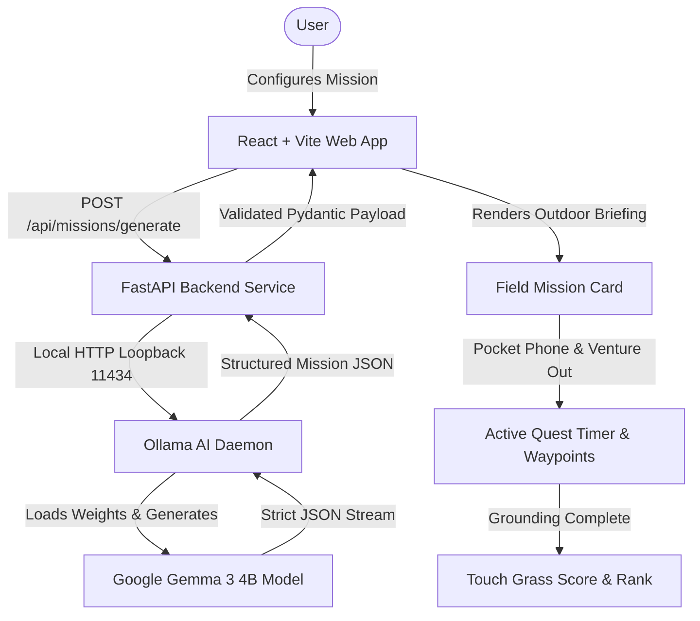
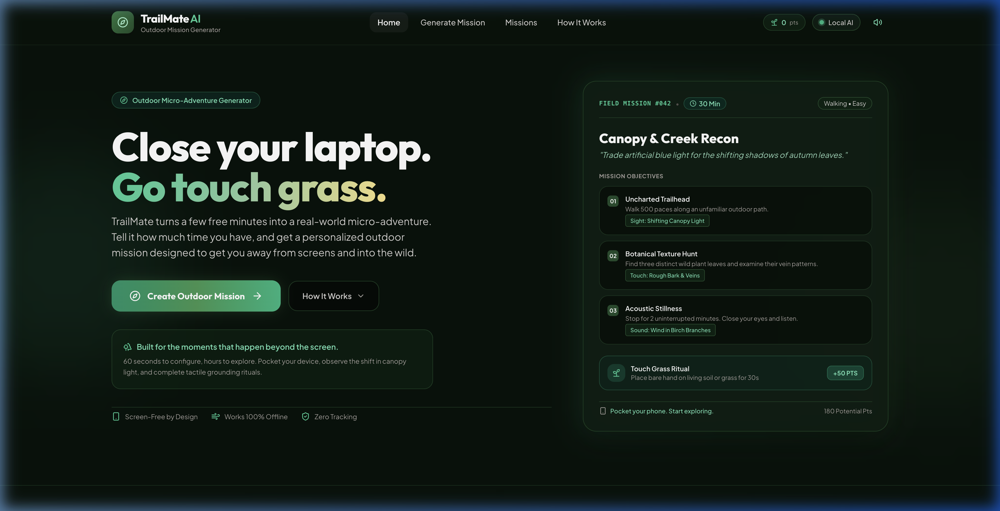
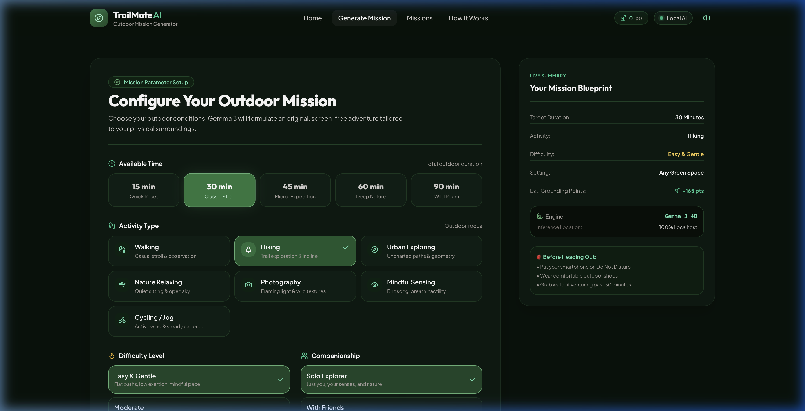
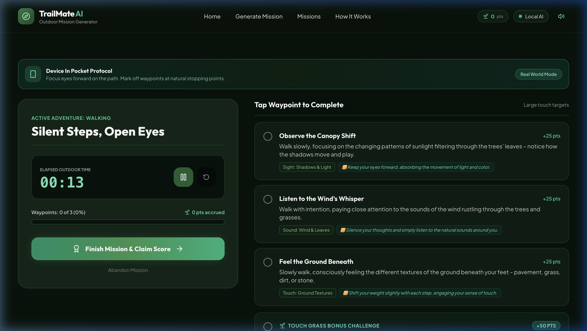
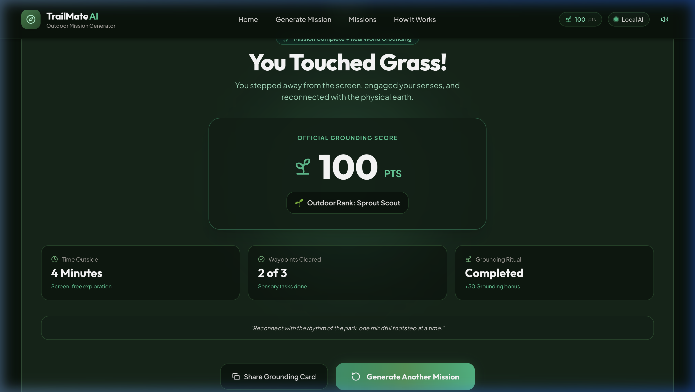

# TrailMate AI 🌿

> **Personalized outdoor micro-adventures powered by local open-weight AI.**

[](LICENSE)
[](https://www.python.org/)
[](https://fastapi.tiangolo.com/)
[](https://react.dev/)
[](https://ollama.com/)
[](https://ai.google.dev/gemma)

---

## 🌲 What is TrailMate AI?

**TrailMate AI** is an intelligent outdoor mission generator built to break digital screen fatigue. In under 60 seconds, it turns a few spare minutes into a tailored, real-world micro-adventure designed around physical perception, natural observation, and tangible grounding rituals.

Instead of relying on proprietary cloud APIs or data-mining services, TrailMate AI runs generative intelligence **directly on your personal machine** using Google's open-weight **Gemma 3 4B** model via **Ollama**.

---

## 🎯 Why It Exists

Modern developers and knowledge workers are inundated with persistent notifications, terminal windows, code reviews, and artificial blue light. Most digital software is engineered to maximize session duration—driving users into endless chatbot dialogues, infinite scroll feeds, and continuous screen fixation.

**TrailMate AI flips this paradigm on its head:**
- **The screen is the shortest part of the experience**: Configure your mission in under a minute, read your field briefing, and put your phone in your pocket.
- **Sensory restoration**: Tasks emphasize non-digital awareness—observing the shift in canopy shadows, tracking birdsong, feeling tree bark grain, and noticing changes in wind.
- **Physical grounding**: Every quest concludes with a literal hands-on grounding ritual (e.g., placing bare hands on living soil, moss, or grass for 30 seconds).

---

## 🧭 How It Works

1. **Choose Your Window**: Select your available time (15 to 90 minutes), outdoor pace (walking, hiking, exploring, photography, relaxing, mindfulness), difficulty, and companionship (solo, friends, family, dog).
2. **Local AI Synthesis**: The local FastAPI backend submits a structured prompt to Gemma 3 4B running inside Ollama on localhost.
3. **Structured Field Briefing**: Receive a personalized outdoor briefing containing sequential milestones, sensory focus cues, safety notes, and an earth-touching grounding ritual.
4. **Pocket Phone & Explore**: Put your device away. Complete the physical waypoints at your own pace with a distraction-free outdoor stopwatch.
5. **Claim Touch Grass Points**: Check off milestones, earn cumulative Grounding Points, and progress through outdoor ranks from *Sprout Scout* to *Ancient Forest Warden*.

---

## 🛠️ Tech Stack

- **Frontend**: React 18, Vite, Tailwind CSS, Lucide Icons, Canvas Confetti, Web Audio API (synthesized chime & click feedback).
- **Backend**: Python 3.10+, FastAPI, Pydantic v2 schemas, HTTPX async client, Uvicorn ASGI server.
- **Local AI Engine**: Ollama runtime powering Google Gemma 3 open-weight models (`gemma3:4b` primary, `gemma3:1b` high-speed alternative).
- **Persistence**: Browser `localStorage` for privacy-first, zero-cloud tracking of points and mission history.

---

## 🏛️ Architecture



### Component Breakdown:
- **React Frontend (`frontend/`)**: Responsive, nature-inspired user interface styled with Tailwind CSS. Includes sticky desktop navigation, responsive mobile drawer, form parameter validation, active stopwatch, and audio effects.
- **FastAPI Service (`backend/app/`)**: Validates input parameters, checks Ollama connectivity, enforces structured prompt engineering, and parses JSON output with automatic bracket/truncation repair.
- **Ollama (`localhost:11434`)**: Local model execution server running Google Gemma 3 open weights on CPU/Metal without sending data over the public internet.

---

## 🧠 Gemma 3 & Ollama: On-Device Sovereign AI

### Why Gemma?
- **Google Open Weights**: Gemma represents state-of-the-art open reasoning developed from the same technological lineage as Gemini.
- **Structured JSON Adherence**: Gemma 3 excels at following strict JSON output constraints, making it ideal for software that transforms natural language into typed frontend interfaces.
- **Responsible & Safe Guidance**: Built with safety principles to recommend accessible, non-hazardous public outdoor exploration without dangerous advice.

### Local AI & Privacy Guarantees
- **Zero Cloud API Keys**: No OpenAI, Anthropic, or proprietary subscription keys required.
- **100% On-Device Telemetry**: Your outdoor routine, preferred locations, and schedule never leave your computer.
- **True Offline Capability (Post-Setup)**: After the software and open-weight model are downloaded to your disk, mission generation and active tracking run completely locally without requiring internet access.

---

## ✨ Features

- ⏱️ **Flexible Duration Slices**: Presets from quick 15-minute desk resets up to 90-minute wild trail excursions.
- 🌿 **Tailored Activity Profiles**: Specialized mission algorithms for walking, hiking, neighborhood exploring, photography, cycling, and quiet mindfulness.
- 👁️ **Sensory Perception Checkpoints**: Explicit prompts encouraging tactile touch (tree bark, smooth stones), sound mapping (birdsong, rustling leaves), and visual observation (canopy light, leaf veins).
- 🌾 **Touch Grass Grounding Ritual**: Hands-on connection with living soil, grass, or moss for 30 uninterrupted seconds.
- 🏆 **Gamified Grounding Ranks**:
  - 🌱 *Sprout Scout* (0–100 pts)
  - 🌾 *Earth Pilgrim* (100–180 pts)
  - ⛰️ *Wildwood Pathfinder* (180–250 pts)
  - 🌲 *Ancient Forest Warden* (250+ pts)
- 📱 **Screen-Free Protocol**: Visual and audio reminders to pocket devices during active quests.
- 🎧 **Subtle Ambient Audio**: Lightweight synthesized Web Audio feedback for button presses, task checkoffs, and mission victory.
- 📱 **Fully Responsive**: Optimized for desktop monitors (up to 1480px content width), tablets, and mobile devices (375px–430px) with dedicated slide-out drawer navigation.

---

## 📸 Screenshots

| Desktop Field Hero | Mission Briefing Card |
| :---: | :---: |
|  |  |

| Active Quest Mode | Mission Complete & Score |
| :---: | :---: |
|  |  |

---

## 📂 Project Structure

```
trailmate-ai/
├── README.md                 # Project documentation & overview
├── LICENSE                   # MIT License
├── .gitignore                # Git exclusions (environments, caches, node_modules)
├── run.sh                    # Unified startup automation script
├── docs/
│   └── screenshots/          # Application interface screenshots
├── backend/
│   ├── requirements.txt      # Python dependencies (fastapi, uvicorn, pydantic, httpx)
│   ├── .env.example          # Environment variable reference template
│   ├── app/
│   │   ├── __init__.py       # App package marker
│   │   ├── config.py         # Application configuration & settings
│   │   ├── main.py           # FastAPI entrypoint, middleware, lifespan
│   │   ├── models.py         # Pydantic data schemas & validation
│   │   ├── ollama_client.py  # Local Ollama client with JSON repair
│   │   ├── prompts.py        # System prompt & structured mission prompts
│   │   └── routes/
│   │       ├── __init__.py   # Router package marker
│   │       ├── health.py     # GET /api/health diagnostic route
│   │       └── missions.py   # POST /api/missions/generate route
│   └── tests/
│       ├── __init__.py       # Tests package marker
│       └── test_api.py       # Pytest suite for API validation
└── frontend/
    ├── index.html            # Web application entrypoint
    ├── package.json          # Node dependencies & npm scripts
    ├── package-lock.json     # Deterministic dependency lockfile
    ├── vite.config.js        # Vite bundler configuration & backend proxy
    ├── tailwind.config.js    # Tailwind theme tokens & nature palette
    ├── postcss.config.js     # PostCSS processor config
    └── src/
        ├── main.jsx          # React DOM root entrypoint
        ├── index.css         # Global Tailwind directives & layout container
        ├── App.jsx           # Main application state machine & routing
        ├── components/
        │   ├── Navbar.jsx            # Sticky navbar with mobile drawer
        │   ├── Hero.jsx              # Landing hero & preview card
        │   ├── LandingSections.jsx   # Product workflow, showcase, engine & ranks
        │   ├── MissionForm.jsx       # Parameter configuration form & live blueprint
        │   ├── MissionCard.jsx       # Generated quest briefing display
        │   ├── ActiveMission.jsx     # Stopwatch timer & interactive checklist
        │   ├── MissionComplete.jsx   # Victory screen, score & rank progression
        │   ├── AiStatusBadge.jsx     # Compact local AI health indicator
        │   ├── AiStatusModal.jsx     # Local Ollama diagnostics modal
        │   └── OfflineExplainer.jsx  # Offline architecture details
        └── utils/
            ├── sound.js      # Web Audio API synthesized chimes & clicks
            └── storage.js    # LocalStorage Grounding Points manager
```

---

## 🚀 Setup & Installation

### Prerequisites
- **Node.js** (v18 or higher) & **npm**
- **Python** (v3.10 or higher)
- **Ollama** ([Download Ollama](https://ollama.com))

---

### Step 1: Install Ollama & Pull Gemma 3

1. Install Ollama:
   - macOS / Linux: `curl -fsSL https://ollama.ai/install.sh | sh` or `brew install ollama`
   - Windows: Download installer from [ollama.com](https://ollama.com)

2. Start the Ollama local daemon:
   ```bash
   ollama serve
   ```

3. Download the Google Gemma 3 4B open weights:
   ```bash
   ollama pull gemma3:4b
   ```
   *(Optional high-speed lightweight fallback for low-power CPUs: `ollama pull gemma3:1b`)*

---

### Step 2: Automated Launch (Recommended)

From the project root:

```bash
chmod +x run.sh
./run.sh
```

`run.sh` will automatically:
- Confirm Ollama is reachable.
- Create `backend/.venv` and install Python requirements.
- Install frontend npm dependencies.
- Launch the FastAPI backend on `http://127.0.0.1:8000`.
- Launch the Vite frontend on `http://localhost:5173`.
- Gracefully shut down all background processes when you press `Ctrl+C`.

---

### Step 3: Manual Step-by-Step Setup (Alternative)

#### 1. Backend Setup:
```bash
cd backend
python3 -m venv .venv
source .venv/bin/activate
pip install -r requirements.txt
cp .env.example .env

# Start FastAPI server
PYTHONPATH=. uvicorn app.main:app --host 127.0.0.1 --port 8000 --reload
```

#### 2. Frontend Setup:
```bash
cd frontend
npm install

# Start Vite dev server
npm run dev
```

Open your browser to: **`http://localhost:5173`**

---

## 🧪 Testing & Validation

### Run Backend Tests:
```bash
PYTHONPATH=. backend/.venv/bin/pytest backend/tests/test_api.py
```

### Check Backend Health:
```bash
curl -s http://127.0.0.1:8000/api/health
```

### Build Production Frontend:
```bash
cd frontend
npm run build
```

---

## 🔧 Troubleshooting

| Issue | Cause | Solution |
| :--- | :--- | :--- |
| **"Local AI isn't available right now"** | Ollama daemon is not running | Run `ollama serve` in a terminal window. |
| **"Requested model 'gemma3:4b' not found"** | Model weights have not been pulled | Run `ollama pull gemma3:4b`. |
| **Generation takes > 60 seconds on older CPUs** | Gemma 3 4B running on CPU | Run `ollama pull gemma3:1b` and set `OLLAMA_MODEL=gemma3:1b` in `backend/.env`. |
| **Port 8000 or 5173 already in use** | Lingering background process | Terminate the existing process: `lsof -i :8000` or `lsof -i :5173`. |

---

## 🌿 Hacktoberfest 2026 — Week 1

- **Challenge**: Hacktoberfest Open-Source AI Challenge — Week 1
- **Theme**: **"Touch Grass"**
- **Project Name**: TrailMate AI

### How TrailMate AI Addresses the Theme:
TrailMate AI was conceived and built specifically for the *"Touch Grass"* challenge. Instead of using generative AI to deepen digital immersion, TrailMate uses AI as a launchpad to exit the screen. By calculating non-screen waypoints, providing sensory focus prompts, and requiring a literal 30-second tactile earth connection, the software measures its ultimate success by how quickly the user closes their laptop and heads into the open air.

*(This repository is submitted to the Hacktoberfest 2026 DEV Challenge Week 1).*

---

### Best Use of Gemma

TrailMate AI utilizes **Google Gemma 3 4B** as its core generative engine:
- The entire outdoor mission synthesis is generated on-device via Gemma 3 running through Ollama.
- Gemma crafts contextually unique waypoints based on requested time, pace, companionship, and setting.
- Prompt engineering enforces strict, validated JSON generation without requiring proprietary cloud endpoints.
- Demonstrates how open-weight models enable sovereign, privacy-preserving consumer software for personal wellbeing.

---

## 🚀 Future Improvements

- 🗺️ **Offline Topological Trails**: Optional GPX trail route overlays and offline OpenStreetMap tile caching.
- 📱 **Progressive Web App (PWA)**: Complete offline service-worker caching for mobile installation.
- 🐾 **Companion Modes**: Expanded sensory tracks for canine agility and family scavenger games.
- 📈 **Streak Grounding Journal**: Local-only habit tracker recording outdoor minutes over consecutive weeks.

---

## 📄 License

This project is licensed under the **MIT License** — see the [LICENSE](LICENSE) file for details.  
Copyright (c) 2026 TrailMate AI Contributors.
